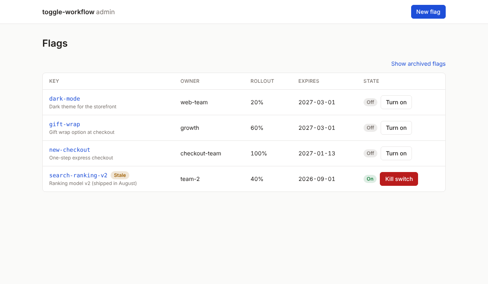
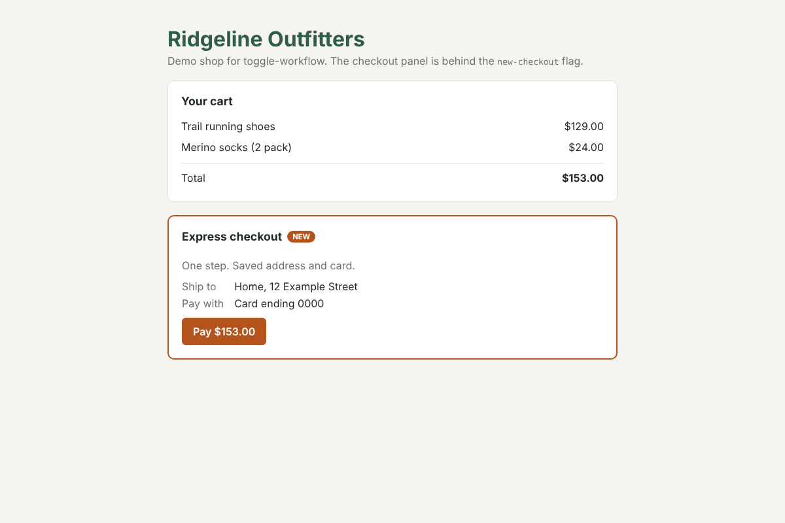

# toggle-workflow

Every feature has one home: its flag.

A feature-flag platform where the flag is the unit of delivery. Code for a feature merges to `main` early, switched off. The flag tracks which PRs belong to it, gates each of them, gives a preview link with the feature switched on, and decides when it is released.

## How it works

- **PRs merge dark.** A PR does not wait for the feature to be finished. It merges with the flag off; the flag's state is the release, not the merge.
- **PRs link to flags automatically.** The diff is scanned for flag calls (`useFlag("new-checkout")`, `isEnabled("new-checkout")`); a PR label covers what the scan cannot see.
- **Each linked PR runs two checks:**
  1. **Flag off: existing regression suite.** Proves merging the unfinished feature is safe.
  2. **Flag on: the feature's own tests.** Proves the feature still works.

  Each flag is checked on its own, with every other flag at its default. Teams write the tests; the platform runs and gates them.
- **Previews without per-PR environments.** `main` is deployed once; the SDK accepts a per-viewer override (`?flags=new-checkout:on`), so a preview is a link.
- **Commit trace.** Each commit linked to a flag records a flag-on result, giving the feature a health timeline. When the feature breaks on `main`, bisect searches only that flag's commits.
- **Cleanup is part of the lifecycle.** Every flag has an owner and an expiry. When it ships or is abandoned, the platform lists every code reference to remove.

Limitation: code outside a flag check (shared refactors, changed utilities) runs with the flag off, so the flag-off regression check is mandatory on every PR.

## Layout

| Path | What | Stack |
|---|---|---|
| `apps/admin` | Admin UI: create flags, rollout %, targeting, kill switch, a flag's PRs and preview link | Next.js, React, TypeScript |
| `apps/server` | Flag evaluation API, pushes changes to clients | Node, Fastify |
| `packages/sdk` | Client SDK and shared types: `useFlag` hook, local cache, last-known-value fallback, circuit breaker | TypeScript |
| `apps/demo` | Demo shop whose checkout is behind `new-checkout`; the test subject for phases 3–5 | Next.js, React |

## Roadmap

Each phase is complete and usable on its own.

1. **Flag service** — server, SDK with React hook, admin UI.
2. **PR linking** — GitHub App; flags show their PRs via code references and labels.
3. **Preview links** — override-based previews from a flag's page.
   - **3b. Microfrontends** — flags decide which zone serves a page, and a flag can't turn on before its zone ships.
4. **Merge gate** — flag-off / flag-on checks per PR, then a merge queue.
5. **Commit trace** — per-flag health timeline and flag-scoped bisect.

## Development

```sh
pnpm install
pnpm build
pnpm dev        # server on :4000, admin on :3000, demo shop on :3001
```

Try it: in the admin console create `new-checkout` with rollout 100%, open the shop at
http://localhost:3001, then turn the flag on and off from the admin. The shop switches
checkout within a few seconds, without a reload.

| Admin: flags, stale badge, kill switch | Demo shop with `new-checkout` on |
|---|---|
|  |  |

- **Admin** (`apps/admin`) calls the flag server from the server side only (Server Components and Server Actions), at `FLAG_SERVER_URL` (default `http://localhost:4000`). The browser never talks to the flag server, so the admin token added in phase 2 stays server-side.
- **Demo** (`apps/demo`) evaluates flags in the browser through a same-origin rewrite: `/flags/v1/evaluate` on the demo is forwarded to `FLAG_SERVER_URL`. Only that endpoint is forwarded, so the admin API is not reachable through the shop, and no CORS is needed. The flag client is created in the browser only; server rendering shows flags off, so a visitor with a flag on sees the old UI until the client loads (instant on repeat visits, from the stored snapshot).

The server exposes these endpoints on port 4000:

| Method | Endpoint | Purpose |
|---|---|---|
| `GET` | `/healthz` | Health check |
| `POST` | `/v1/admin/flags` | Create a flag |
| `GET` | `/v1/admin/flags` | List flags; `?includeArchived=true` includes archived flags |
| `GET` | `/v1/admin/flags/:key` | Get a flag |
| `PATCH` | `/v1/admin/flags/:key` | Update mutable flag fields |
| `DELETE` | `/v1/admin/flags/:key` | Archive a flag |
| `POST` | `/v1/evaluate` | Evaluate all active flags for a context |

Errors use `{ "error": { "code": "...", "message": "...", "details": [] } }`;
`details` lists every invalid field as `{ field, message }` (e.g. `/owner`), for validation
errors and `INVALID_EXPIRY`.
Common codes include `VALIDATION_ERROR`, `INVALID_JSON`, `UNSUPPORTED_MEDIA_TYPE`,
`BAD_REQUEST`, `NOT_FOUND`, `FLAG_EXISTS`, `FLAG_ARCHIVED`, `INVALID_EXPIRY`, and
`INTERNAL_ERROR`.

## SDK

```ts
import { createFlagClient } from "@toggle-workflow/sdk";
import { FlagProvider, useFlag } from "@toggle-workflow/sdk/react";

const client = createFlagClient({
  baseUrl: "http://localhost:4000",
  context: { userKey: "user-123", customerId: "acme" },
  // pollIntervalMs: 30000, timeoutMs: 2000, fetch
});

client.isEnabled("new-checkout"); // synchronous; unknown flags are false

function Checkout() {
  return useFlag("new-checkout") ? <NewCheckout /> : <OldCheckout />;
}
// <FlagProvider client={client}><Checkout /></FlagProvider>
```

- **Never throws, never blocks rendering.** Values are read from memory; network, timeout and storage errors are absorbed.
- **Last-known values.** The last good snapshot is kept in memory and `localStorage` (when available) and served on the next startup before the first response.
- **Circuit breaker.** 3 consecutive failures or timeouts open it; while open no requests are sent; after a cooldown (5s, doubling to 60s per failed probe) one probe is sent; success closes it. `client.status()` is `"live"`, `"cached"` or `"degraded"`.
- **One client per page.** Calls with the same `baseUrl` and context share one client, even across separately bundled copies of the SDK (microfrontends). `close()` releases a handle; polling stops when the last one closes.
- `@toggle-workflow/sdk` has no React dependency; `@toggle-workflow/sdk/react` needs React 19.

## License

Copyright (c) 2026 Pramathesh Malshe. All rights reserved. Public for reading and evaluation only; see [LICENSE](LICENSE).
